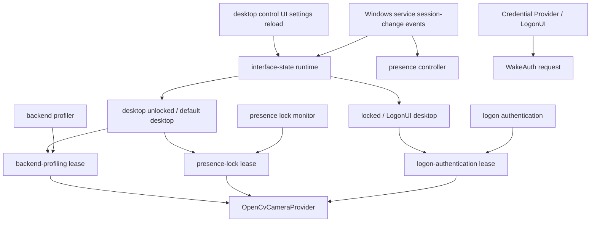

# Camera identity and backend profiling

## Device binding

Windows discovery reads Media Foundation activation metadata without opening a
video stream. Each listed `CameraId` is `windows-device:<device interface path>`,
using `MF_DEVSOURCE_ATTRIBUTE_SOURCE_TYPE_VIDCAP_SYMBOLIC_LINK`. Friendly names
are display-only. Paths are normalized case-insensitively for comparison;
missing or ambiguous identities are rejected instead of falling back to a name.

Media Foundation and DirectShow have independent enumeration orders. Immediately
before each backend opens, the provider resolves the saved path to that backend's
current index. DirectShow reads each moniker's `DevicePath` property, without
binding a capture filter. SetupAPI resolves DirectShow capture-class paths to Media Foundation camera-class aliases; the OS requires the same device and reference string, so distinct RGB/IR endpoints are not merged. Missing aliases keep exact-path comparison and fail closed if no unique match exists. An enumeration check after open rejects observable
hotplug/reordering during the open. `CAP_ANY` is deliberately excluded because
its backend selection cannot preserve the association between a path and an index.
The legacy `Any` enum remains deserializable; ordinary opens treat it as the
explicit DirectShow / Media Foundation fallback order unless a measured preference
selects Media Foundation first.

`CameraId::validate()` checks syntax only. `resolve_camera_id()` performs metadata
resolution. New enrollment/application and legacy service configuration migration
persist the returned identity. A legacy `opencv-index:N` still means the current
Media Foundation slot N at the initial binding; historical physical identity
cannot be reconstructed from an old index alone. After migration, reordering or
an identically named replacement cannot redirect that binding. A device without
an available path fails closed. USB devices without stable serial numbers can
receive another interface path when moved to a different port; the user must
select/rebind that device instead of silently selecting a substitute.

Microsoft documents the [Media Foundation symbolic-link attribute](https://learn.microsoft.com/en-us/windows/win32/medfound/mf-devsource-attribute-source-type-vidcap-symbolic-link)
the unique DirectShow [DevicePath property](https://learn.microsoft.com/en-us/windows/win32/directshow/selecting-a-capture-device), and the device/reference guarantee of [SetupDiGetDeviceInterfaceAlias](https://learn.microsoft.com/en-us/windows/win32/api/setupapi/nf-setupapi-setupdigetdeviceinterfacealias).

## Probe policy and latency

Profile lookup is passive: it reads the saved preference without starting a
thread, enumerating devices, or opening a stream. There is no 30-second camera
poll, and session unlock/logon does not start profiling. Device identity is still
resolved against current metadata when a business operation actually opens the
camera, so removing background polling does not reintroduce stale index binding.

- Backend probing is an explicit diagnostic operation. Unknown/locked sessions
  are rejected before enumeration; interrupted probes return an error without
  scheduling a hidden retry. Saved timestamps/status remain available for diagnostics.
- A known-good backend is tested first. The first backend that returns a valid
  frame within 3000 ms wins. This is a first-usable policy, not a global fastest
  backend benchmark. There is no unconditional 1500 ms pause between attempts.
- Foreground capture, the worker, and profiling share `windows_camera_backend_order`.
  With no measured preference (including an index-to-stable-ID cache miss), try
  DirectShow first, then Media Foundation. A measured Media Foundation preference
  still takes precedence. Do not copy an old index profile to a physical identity
  based on its friendly name. The default addresses the observed C920 regression;
  it does not assert DirectShow is faster for every device.
- The only Windows candidates are Media Foundation and DirectShow. Every probe
  uses `OpenCvCameraProvider::open_backend` with exactly one backend, including
  the provider's bounded first-frame warm-up and process deadline.
- A backend attempt holds its own camera lease. Locking stops further backend
  and device attempts. Interrupted devices
  receive no fresh success/failure timestamp. Already-blocked native code is
  bounded by the isolated worker's deadline.
- A transient failed/slow explicit probe retains a previously usable backend and
  records the failed attempt without reclassifying it as a successful measurement.
- Normal camera release sends `Close`, waits up to one second for `Closed` after
  driver/capture release, then allows a short process-exit grace period. Transport
  failures, driver hangs, or a parent exit still terminate the isolated worker.

`open_ms` measures worker startup, device resolution, open, and the first readable
frame. `read_ms` measures transfer of that already-validated first frame. The
`camera-open-benchmark` command uses the same isolated, exact-backend path and
reports the resolved stable ID. Its explicit backends are `msmf` and `dshow`.
`--backend auto` exercises the ordinary configured-preference/fallback path and
prints `selected_backend`; it captures one frame without saving an image or
requesting authentication. Logon camera-open completion also logs the selected
backend and elapsed `open_ms`.

## Storage

Profiles live at `<install-dir>\runtime\camera_backend_profiles.json`, keyed by
stable `camera_id`. An old index-keyed profile is not reassigned by friendly name.
The persisted `last_attempt_unix_ms` records attempts independently from the last
successful `measured_at_unix_ms`; older files default the attempt timestamp to
their measurement time. Status is `usable`, `degraded`, or `unavailable`. These
timestamps no longer create autonomous retry jobs.

Authentication reads a metadata-keyed in-process cache. A temporarily unreadable
or partially written profile file keeps the last readable snapshot, with no
foreground sleep/retry loop. Profile lookup never opens a stream. Ordinary face
authentication, opt-in enrollment/diagnostics, and input-gated presence sampling
still use the camera when their business conditions allow it.
## Camera Runtime Boundary

Business modules should depend on a resolved camera runtime configuration:

```text
camera_id
preferred_backend
requested_frame_width
requested_frame_height
fallback backend order
```

The ownership boundary is:

```text
face enrollment / unlock / presence / diagnostics
  -> request a camera runtime config
camera backend profile service
  -> owns profiling, profile persistence, degradation policy, and logs
OpenCvCameraProvider
  -> owns the platform adapter and final fallback attempts
```

This keeps backend policy and device identity resolution out of feature code;
features share the same stable binding and exclusive camera lease rules.

## Interface State And Camera Lease Runtime

The service owns a single interface-state and camera-lease runtime. Feature
modules must not open the camera just because they have a camera id. They must
first acquire a lease from the runtime.



Interface-state source:

- `desktop unlocked` is set only by trusted service-side lifecycle events:
  `SessionLogon`, `SessionUnlock`, or an explicit desktop control settings
  reload.
- `locked / LogonUI` is set by `SessionLock`, `SessionLogoff`,
  `ConsoleDisconnect`, `RemoteDisconnect`, and `SessionTerminate`.
- `unknown` is the startup state and is fail-closed for background camera
  consumers.
- `active_user_session_id()` is not a lock-state source. It is only a session
  existence helper for deciding which user session a desktop control reload can
  target.
- The service must not use `OpenInputDesktop` as the state source. The service
  runs as LocalSystem in Session 0, so the input desktop observed from that
  process is not a reliable proxy for the interactive user's lock/unlock state.

Lease rules:

- `locked / LogonUI` allows only logon authentication to open the camera.
- `desktop unlocked` allows presence lock monitoring and backend profiling.
- backend profiling runs only when the desktop is unlocked and no other camera
  lease exists.
- `unknown` allows only logon authentication. This keeps LogonUI unlock usable
  when the service cannot query the input desktop, while preventing background
  desktop tasks from taking the camera during ambiguous states.
- logon authentication may wait briefly for an in-flight camera holder to drop;
  presence monitoring and profiling should not wait and should yield instead.

Implementation boundary:

- `camera_runtime` owns interface-state detection, lease arbitration, and lease
  release.
- `service_host` treats session-change events as presence monitor start/stop
  triggers and updates `camera_runtime` before the presence command is sent.
- desktop control settings reloads are allowed to mark the runtime as desktop
  unlocked because that request is initiated from the interactive desktop UI.
- `auth_issuer`, `presence_camera`, `presence_person_camera`, and
  `camera_backend_profiles` must acquire a lease before creating or opening
  `OpenCvCameraProvider` / `VideoCapture`.
- A lease is released by `Drop`; long-running presence sources hold a lease for
  their source lifetime, short one-shot users hold it only while the camera is
  open.

## Observability

Service log records:

- profiling start/completion
- per-camera selected backend and timing
- probe failures
- degraded probe candidates that were not persisted as preferred
- cases where an existing good profile was kept
- cases where an existing bad profile was ignored or removed
- explicit refresh completion or deferral (no device-change polling job)

No credentials or frame image data are logged.

## Test Strategy

- Unit test JSON read/write selection.
- Unit test backend ordering uses profile first.
- Manual diagnostic command: `camera-open-benchmark`.
